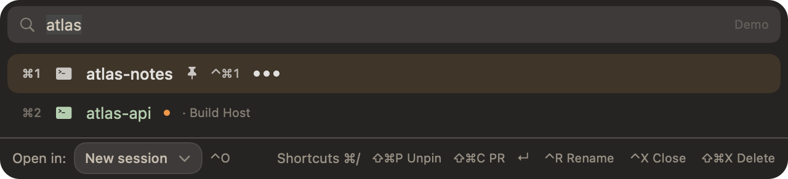
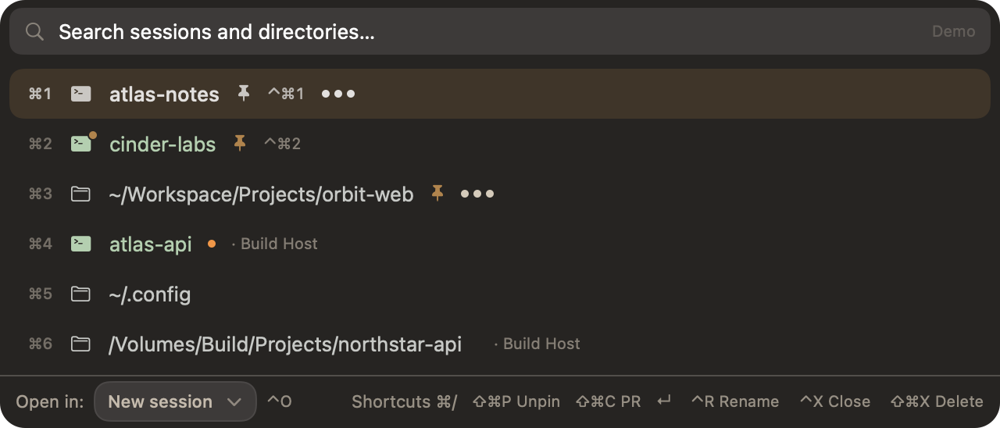
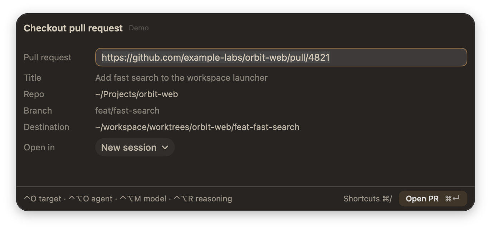
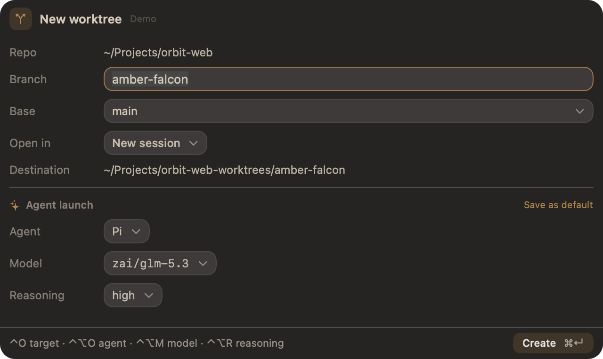

# Raptor

A keyboard-first launcher for [Rex](https://www.superlogical.com/rex/docs). Find a session or project, then switch to it or open it where you want to work.

| Search and switch | Pinned sessions |
| --- | --- |
|  |  |

| Pull request form | Worktree form |
| --- | --- |
|  |  |

[More screenshots](docs/screenshots/README.md) · [Usage and design notes](docs/native-app.md) · [Session behavior](docs/sessions.md)

## Why Raptor

- **Find and switch fast.** Search live sessions and project directories across Rex hosts. Open as a session, tab, shell, or pane split; open a directory to start a session there.
- **Keep favorites close.** Pin sessions and directories. Jump to pinned sessions from anywhere in Rex with `⌃⌘1`–`⌃⌘9`.
- **Work in parallel.** Create and open Git worktrees using [Worktrunk](https://github.com/bvdeenen/worktrunk) for branch-aware paths and cleanup. `⇧⌘N` opens the form; `⌘⌥N` instantly creates a worktree, switches to its new session, and starts Pi.
- **Review PRs in context.** Paste a GitHub pull-request URL to create or reuse its worktree and open it in a session or tab.
- **Stay safe.** Worktree deletion checks status and branch integration before removal; closing a session requires explicit consent.

## Install

Requires macOS 14+, Rex, Git, [zoxide](https://github.com/ajeetdsouza/zoxide), [Worktrunk](https://github.com/bvdeenen/worktrunk), and [gh](https://cli.github.com/) for pull requests. Homebrew installs zoxide, Worktrunk, and gh for you.

```sh
brew install alienxp03/tap/raptor
raptor init
rex config reload
```

`raptor init` adds the plugin and default Rex bindings to your config.

## Shortcuts

| Key | Action |
| --- | --- |
| `⇧⌘O` | Open Raptor |
| `⇧⌘C` | Check out a pull request |
| `⇧⌘N` | Create a worktree (form) |
| `⌘⌥N` | Instant Pi worktree in a new session |
| `⇧⌘P` | Pin or unpin the selected session or directory |
| `⌃⌘1`–`⌃⌘9` | Jump to a pinned session, Rex-wide |
| `⌃P`, then `H J K L` | Choose a pane split |

In the picker, type to search; `↑`/`↓` or `Ctrl+J`/`Ctrl+K` moves through results. `Ctrl+O` changes the open target. `⌘/` shows the searchable, context-sensitive shortcut list.

## Customize keybindings

`raptor init` adds these default Rex bindings. You can add alternatives or replace defaults in your Rex config (`~/.config/rex/init.lua`). Keep custom lines outside the `raptor` managed block so `raptor init` preserves them.

| Default key | Rex action | What it does |
| --- | --- | --- |
| `⇧⌘O` | `raptor` | Open the picker |
| `⇧⌘C` | `raptor_pr_open` | Check out a pull request |
| `⇧⌘N` | `raptor_worktree_new` | Open the create-worktree form |
| `⌘⌥N` | `raptor_worktree_agent` | Create an instant Pi worktree |
| `⌃⌘1`–`⌃⌘9` | `raptor_pin_1`–`raptor_pin_9` | Jump to a pinned session |

To change what a key does, bind that same key again; the later binding wins, so no unbind is needed. To move Raptor to a new key and free the old one, add this after the managed block:

```lua
rex.unbind("shift+cmd+o", "raptor")
rex.bind("ctrl+cmd+o", "raptor")
```

To keep the default and add an alternative, just add the new `rex.bind`. Reload with `rex config reload`. Other shortcuts in the picker are app-level; view the full current list with `⌘/`.

## Worktree

Raptor uses [Worktrunk](https://worktrunk.dev/) to create and manage worktrees. Configure worktree paths in [Worktrunk's config](https://worktrunk.dev/config/) and hooks in its [hook config](https://worktrunk.dev/hook/). Use `wt list` and `wt remove` to manage worktrees outside Raptor. Project setup hooks run visibly in the destination terminal.

## Development

```sh
git clone https://github.com/alienxp03/raptor ~/.config/rex/raptor
cd ~/.config/rex/raptor && make install
make test
make test-macos
```

On macOS, `make install` installs the CLI/backend and Rex plugin. To refresh the synthetic screenshots, run `scripts/capture-showcase.sh`.

[MIT License](LICENSE)
