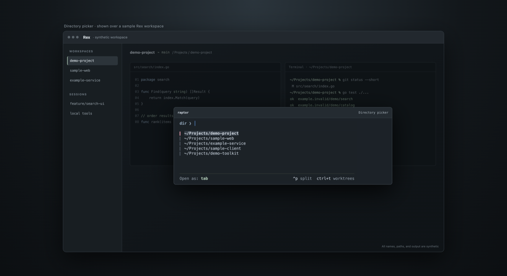
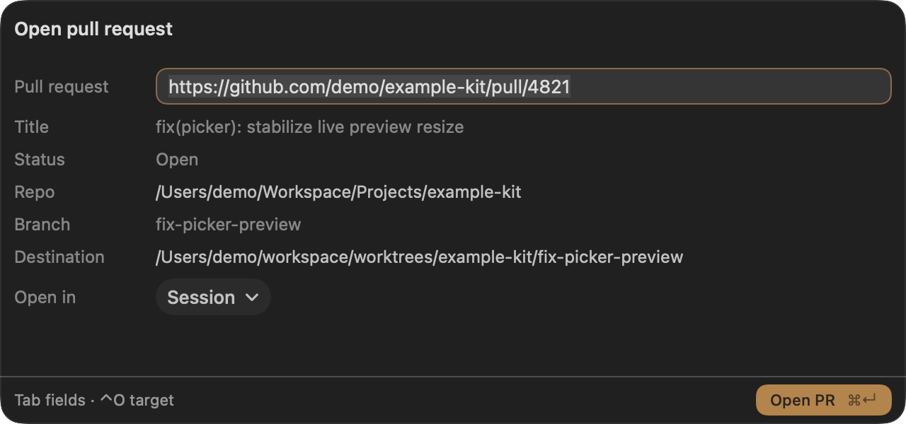
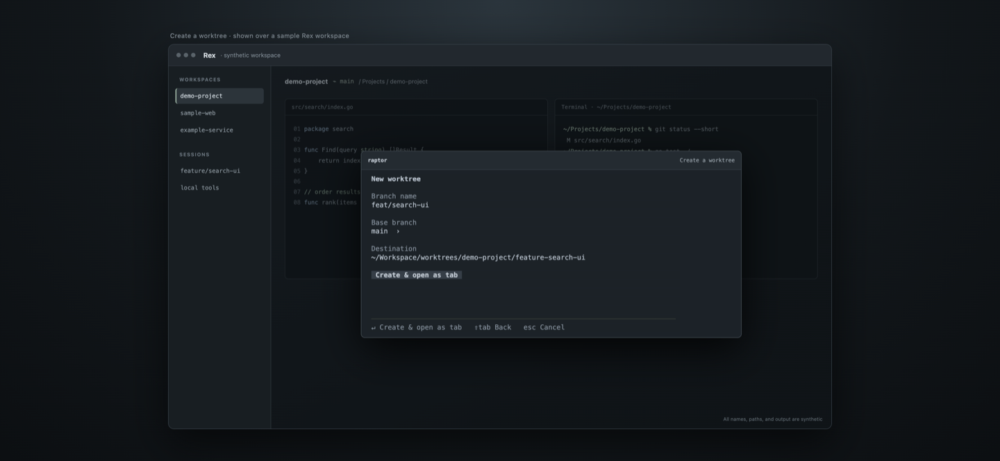

# Raptor

A session and project launcher for [Rex](https://www.superlogical.com/rex/docs). One sesh-style list to resume a session or open a project directory — as a session, tab, pane split, or the current shell. Create Git worktrees and open GitHub pull requests without leaving the keyboard.

Native SwiftUI picker on Mac over one shared Go backend.

<p align="center">
  
</p>

| | |
| --- | --- |
|  |  |

*Open a pull request · Create a worktree. Synthetic data; [gallery](docs/screenshots/README.md).*

## Highlights

- **Resume, don't re-pick** — the launcher defaults to the most-recent *other* session; `Cmd+P`/`Ctrl+P` bounces to the last one. Sessions and zoxide directories from every connected host in one searchable list, with live working/blocked indicators and a terminal preview on wide screens.
- **Open anywhere** — targets: session → tab → current shell → pane right/below. `Ctrl+P` starts a directional split.
- **Worktrees** — create from a searchable base branch with a validated destination preview, then open and start setup in a visible terminal. Instant Pi worktrees skip the form entirely.
- **Pull requests (Mac)** — paste any GitHub PR URL; Raptor reuses or clones the repo and opens the PR worktree in a session or tab. Closed/merged PRs with deleted branches get a confirmed commit checkout on an isolated `pr/N` branch.
- **Safe by default** — Worktrunk owns paths and hooks; nothing is created without Enter, approvals are never auto-accepted, and failures keep resources for retry.

## Install

Requires macOS 14+, [Rex](https://www.superlogical.com/rex/docs), Git, [zoxide](https://github.com/ajeetdsouza/zoxide), [Worktrunk](https://github.com/bvdeenen/worktrunk) (`wt`), and [gh](https://cli.github.com/) for pull requests. Homebrew installs zoxide, Worktrunk, and gh for you.

```sh
brew install alienxp03/tap/raptor
raptor init
rex config reload
```

`raptor init` writes one managed `-- >>> raptor >>>` block into your Rex config — plugin, setup, and default bindings (`shift+cmd+o` open, `shift+cmd+n` worktree). Rerun it any time to refresh; nothing outside the markers is touched. Rebind inside the block like any other Rex config.

| Key | Action |
| --- | --- |
| `shift+cmd+o` | Open the launcher |
| `cmd+p` | Return to the last session |
| `shift+cmd+n` | Create a worktree |
| `shift+cmd+p` | Open the pull request form (optional, add inside the block) |

## Usage

The launcher lists live sessions first (the current session pinned and marked), then frecency directories per host. Enter switches to a session or creates one from a directory; `Ctrl+O` cycles the open target first; `Esc` dismisses. A directory row always opens with the default target — `session` reuses any matching session instead of duplicating it.

| Key | Action |
| --- | --- |
| Type | Filter sessions and directories |
| `↑`/`↓`, `Ctrl+J`/`Ctrl+K` | Move through results |
| `Ctrl+O` | Change the open target |
| `Enter` | Switch or open |
| `Ctrl+P`, then `H J K L` | Open in a pane split |
| `Esc` | Clear filter, then dismiss |

### Worktrees

`raptor wt --create` or the `raptor_worktree_new` action opens the create form: branch (a two-word name is suggested), searchable base branch, destination preview, and open target. Enter creates and opens in one step; a failed open leaves **Retry opening** — never a second worktree. Worktrunk's `worktree-path` owns destinations:

```toml
# ~/.config/worktrunk/config.toml
worktree-path = "~/workspace/worktrees/{{ repo }}/{{ branch | sanitize }}"
```

With configured creation hooks, setup runs visibly in the destination terminal and a failure leaves a usable shell plus a retry command. Worktree listing and removal stay in Worktrunk (`wt list`, `wt remove`).

### Pull requests (Mac)

Press `⇧⌘P` (or paste a PR URL into search) and confirm. Raptor resolves metadata, reuses a matching local clone or clones `~/workspace/<owner>/<repo>`, then creates the worktree and opens it with visible setup. Closed or merged PRs whose branch was deleted offer **Check out PR commit…** — an editable worktree on isolated local branch `pr/N`, without restoring or pushing anything. Requires `gh auth login` on the server host.

### Instant Pi worktree

Bind `raptor_task_new` for a formless flow: a two-word branch (`otter-falcon`) is created from the origin repo's committed HEAD, a new tab opens, and fresh `pi` starts — no picker involved, from any Rex client (`raptor task`).

```lua
rex.bind("ctrl+shift+n", "raptor_task_new")
```

## Configuration

Everything is optional.

```toml
# ~/.config/raptor/config.toml
enter = "session"
targets = ["session", "tab", "here", "pane_right", "pane_below"]
```

```lua
require("raptor").setup{
  bounds = { x = 0.28, y = 0.14, w = 0.44, h = 0.40 },
}
```

Direct open without the picker: `rex do raptor target=tab dir=/path/to/project`.

## How it works

```
Rex action on this Mac → Raptor.app (SwiftUI) → bundled raptor api
                                            → shared Go backend
                                            → Rex sessions, dispatch, history
```

The resident Mac host keeps the panel and backend warm between opens (~125 ms warm reopen). Session order follows shared recency history, including sidebar switches observed on Mac. See [sessions](docs/sessions.md), [the native app](docs/native-app.md), and [packaging](packaging/macos.md).

## Development

Build and test from a checkout:

```sh
git clone https://github.com/alienxp03/raptor ~/.config/rex/raptor
cd ~/.config/rex/raptor && make install
```

`make install` on Mac installs `~/Applications/Raptor.app`, its bundled backend as `~/.local/bin/raptor`, and an unchanged installer-owned Rex plugin. Then `require("raptor").setup{}` plus your bindings in `~/.config/rex/init.lua`. Other systems install the CLI only.

Track `master` without a checkout using the HEAD formula (needs repo access, Xcode 26+, and Go):

```sh
brew install --HEAD alienxp03/tap/raptor
brew upgrade --fetch-HEAD alienxp03/tap/raptor
```

Details on private-repo credentials: [packaging](packaging/macos.md).

```sh
make test         # Go and Lua checks
make test-macos   # Swift 6 model/transport checks
make app          # dist/Raptor.app (requires Xcode 26+)
```

## License

[MIT](LICENSE)
