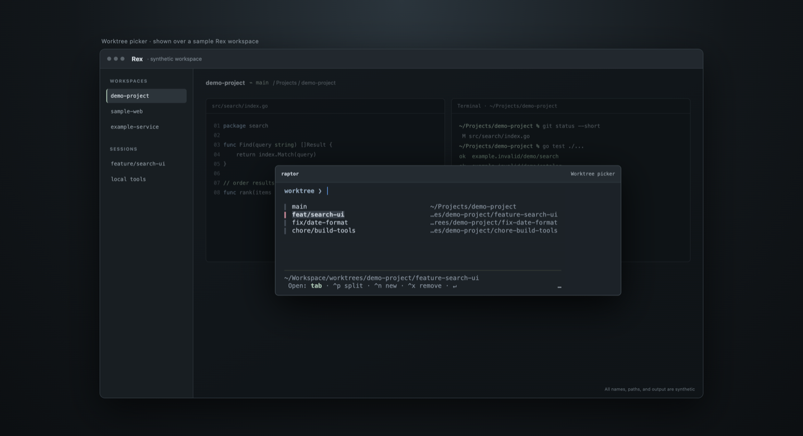
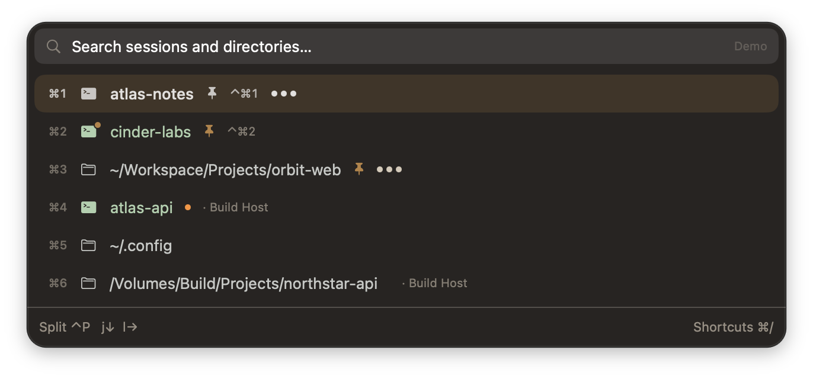

# Raptor

Raptor is a directory and Git worktree picker for [Rex](https://www.superlogical.com/rex/docs). It uses a native SwiftUI picker on Mac and Bubble Tea on mobile. Both interfaces use the same Go search, worktree, and Rex action logic.

Pick a saved directory or worktree, then open it in a tab, session, pane, or the current shell.

## Screenshots

The screenshots show the native macOS UI over an illustrative Rex workspace. All project names, paths, and terminal output are synthetic.

<table>
  <tr>
    <td></td>
    <td></td>
  </tr>
  <tr>
    <td></td>
    <td></td>
  </tr>
</table>

- **Directories:** Filter saved folders and open in a tab, session, or current shell.
- **Agents:** Find Pi, Codex, and Claude agents grouped by Blocked, Working, and Idle, then focus their pane. Working indicators animate across Repos and Agents. See [Agents](docs/agents.md).
- **Worktrees:** Browse local branches and paths; safe removal keeps the branch.
- **Pane splits:** Press Ctrl+P, then H/J/K/L or arrows. Escape cancels.
- **Create:** Search local base branches, preview the path, then create and open in one action.

[Full-size gallery and feature notes](docs/screenshots/README.md).

## Install

### Early Homebrew builds

Install the native app, terminal CLI, and Rex plugin from the current `master`:

```sh
brew install --HEAD alienxp03/tap/raptor
# Quit Raptor before upgrading:
brew upgrade --fetch-HEAD alienxp03/tap/raptor
```

The source remains private. Before installation, install `gh` and add a credential
helper scoped to this repository (existing helpers are retained):

```sh
git config --global --add credential.https://github.com/alienxp03/raptor.git.helper '!gh auth git-credential'
```

Set `HOMEBREW_GITHUB_API_TOKEN` in your shell using your secret manager or
GitHub CLI account with private-repo read access. Homebrew passes it to the Git
fetch helper; it is not written into the package. Normal Keychain-only Git login
is not sufficient inside the fetch sandbox. With that variable set, the install
and upgrade commands above work without extra flags. Do not commit tokens.

These are development builds, not stable releases. Building requires macOS 14+,
Xcode 26+, and Go 1.27.1+ (Homebrew installs Go and zoxide). The formula downloads
Go modules before its offline build. Source access uses your Git credentials.

For a fresh Rex setup, append the packaged module to the Lua search path:

```lua
-- Apple Silicon; use /usr/local for standard Intel Homebrew.
package.path = package.path .. ";/opt/homebrew/opt/raptor/share/?/init.lua"
require("raptor").setup{}
rex.bind("shift+cmd+o", "raptor")
rex.bind("shift+cmd+t", "raptor_worktree_list")
rex.bind("ctrl+n", "raptor_worktree_new")
```

Then run `rex config reload`. Existing plugin checkouts and Rex settings are
not overwritten. Update an existing checkout once to get package discovery.
The plugin prefers a detected Homebrew app/CLI pair through stable `opt` paths,
so upgrades need no config edits. Explicit `bin` and `app` options still win.
A previous `~/.local/bin/raptor` can shadow Homebrew's CLI on PATH; use
`$(brew --prefix raptor)/bin/raptor` to select the packaged CLI explicitly.

### Install from a checkout

Clone the plugin and install Raptor. Building the Mac app requires macOS 14 or later and Xcode 26+; Go and Lua are needed for development and tests.

```sh
git clone https://github.com/alienxp03/raptor ~/.config/rex/raptor
cd ~/.config/rex/raptor
make install
```

On Mac, `make install` builds and installs both `~/Applications/Raptor.app` and `~/.local/bin/raptor`. Use `make install-app` for the app only (including its internal backend), or `make install-cli` for the standalone CLI only. These commands leave the Rex plugin unchanged. On other systems, `make install` installs the CLI only.

Add setup and your own key bindings to `~/.config/rex/init.lua`:

```lua
require("raptor").setup{}
rex.bind("shift+cmd+o", "raptor")
rex.bind("shift+cmd+t", "raptor_worktree_list")
rex.bind("ctrl+n", "raptor_worktree_new")
```

These are example bindings. Change them to keys that work for you. Raptor also adds `raptor`, `raptor_worktree_list`, `raptor_worktree_new`, `raptor_session_last`, and `raptor_pane_last` to the Rex command palette. Reload the Rex config after you change it.

The plugin uses the native app for local macOS clients and the terminal picker for iPhone/iPad or remote Mac clients. The Mac picker opens centered over the terminal window that invoked it (near its top, like a command palette) and stays warm while hidden. Escape dismisses it; Cmd+Q quits completely. Each reopening gets fresh Rex context and a new Go backend. No focus watcher or login item is added. If the app is missing or its launch command fails, it uses the terminal picker. Force the terminal UI with `require("raptor").setup{ ui = "terminal" }`. Set `ui = "gui"` to force the server’s Mac app, including from CLI or iOS; a missing app or failed launch reports an error instead of falling back.

### Instant Pi worktree

`raptor_task_new` skips the form: generate a two-word branch such as
`otter-falcon` by pairing two words from a bundled 473-word list (cryptographically
shuffled; collisions try another pair, never a suffix), create its worktree from the origin repository's committed
HEAD, open and select a new tab, and run fresh `pi` with no initial prompt.
Uncommitted changes stay in the original worktree. This action is independent of
`ui`: Mac and iOS use the same backend flow, without opening either picker.
Pi must be installed on the server host. Missing context, a missing Pi executable,
or an unborn/non-Git repository fails before creating a worktree.

```lua
rex.bind("ctrl+shift+n", function()
  rex.invoke("raptor_task_new")
  return true
end)
```

CLI equivalent: `raptor -client CLIENT task` (session/block default to Rex's
terminal environment). `task --repo /path/to/repo` overrides repository detection.
If opening the tab fails, the error reports the preserved worktree; reuse it with
`raptor -client CLIENT task --resume /path/to/worktree`. If only switching fails,
select the already-created tab rather than creating another task. Tabs stay open
after Pi exits or fails, so startup errors remain visible.

### Experimental two-stage launcher

`raptor launcher` (Rex action `raptor_launcher`) is a terminal-only preview,
separate from the normal terminal picker and native Mac UI. Search a directory,
press Enter to choose an action, then Enter again to run it. Escape returns to
the path list without losing the search or selection. Actions respect configured
`targets`; Git repositories also offer New Worktree and Browse Worktrees.
Existing direct-open and worktree shortcuts are unchanged.

For iOS onscreen modifiers, use a function binding:

```lua
rex.bind("ctrl+m", function()
  rex.invoke("raptor_launcher")
  return true
end)
```

### Local Mac package

```sh
make app                    # dist/Raptor.app, current architecture
make package                # App ZIP and SHA-256 checksum in dist/
./scripts/package-macos.sh --universal  # Intel + Apple Silicon
```

Local builds are ad-hoc signed, **not notarized**. The HEAD formula is published in `alienxp03/tap`; signing/notarization hooks and a cask template remain available for a future tagged binary release. See [Mac architecture and protocol](docs/native-app.md) and [packaging instructions](packaging/macos.md).

## Return to a previous location

```lua
rex.bind("cmd+p", "raptor_pane_last")
```

- `raptor_pane_last`: toggle the pane Raptor left, including across sessions and tabs.
- `raptor_session_last`: toggle the session Raptor left.

Canonical names use resource + action, except `raptor`, which remains the default
launcher. Old action names are no longer registered, keeping the command palette free of
duplicates. Update existing bindings: `raptor_wt` → `raptor_worktree_list`,
`raptor_create` → `raptor_worktree_new`, `raptor_last_pane` → `raptor_pane_last`,
and `raptor_last_session` / `raptor_last` → `raptor_session_last`.

Raptor records the origin when it opens a pane, tab, or different session. Changing directory with `here` does not update pane history. Clicking panes, normal Rex pane shortcuts, and manual tab or session changes do not update either history. No background watcher runs.

Both actions run directly in Lua, without starting Raptor or the Rex CLI. Pane history starts after your first Raptor navigation; closed or detached panes give an error. History is shared by clients on the same server. Rex client selection is queued, not an acknowledgement that the app displayed it.

## Directory picker

Use the `raptor` Rex action for the platform-appropriate UI. `raptor dirs` always opens the terminal picker. Both list saved directory paths only, without icons. Use Rex's Cmd+K for existing sessions and tabs.

| Key | Action |
| --- | --- |
| Type | Filter saved directory paths |
| ↑ / ↓, Ctrl+J / Ctrl+K | Move through results |
| Ctrl+O; Tab / Shift+Tab also work in terminal lists | Change the open target |
| Enter | Open the selected directory |
| Ctrl+P, then H/J/K/L or arrow | Open in a pane split |
| Ctrl+T | Open worktrees for the selected Git repository |
| Ctrl+N / F2 | Open Create worktree directly for the selected Git repository |
| Esc | Clear the filter, then close the picker |

`here` changes directory only when the current pane is at a shell prompt. Session mode reuses a matching session or creates one.

## Worktree picker

Use the `raptor_worktree_list` Rex action for native Mac worktrees or the mobile terminal picker. Run `raptor wt` to use the terminal UI with the current Git repository. Use `raptor wt --repo /path/to/repo` to choose a repository directly. Use `raptor wt --create` for the terminal form, or the `raptor_worktree_new` Rex action to open Create directly using the configured `ui` (`auto` prefers the local Mac app; `terminal` always uses the terminal). Both use the origin pane's repository. Bind it with `rex.bind("ctrl+n", "raptor_worktree_new")` to use it from Pi or a shell. Without a repository in the current pane, Raptor shows a repository picker.

| Key | Action |
| --- | --- |
| Type | Filter worktree branches and paths |
| ↑ / ↓, Ctrl+J / Ctrl+K | Move through worktrees |
| Ctrl+O; Tab / Shift+Tab also work in terminal lists | Change the open target |
| Enter | Open the selected worktree with that target |
| Ctrl+P, then H/J/K/L or arrow | Open in a pane split |
| Cmd+N / Ctrl+N on Mac; Ctrl+N / F2 in terminal | Create a worktree |
| Cmd+Backspace / Ctrl+X on Mac; Ctrl+X / Delete in terminal | Remove a worktree after confirmation |
| Esc | Clear the filter, then return to directories |

Both create forms show labeled **Repo** and **Destination** paths, the branch, base, and open target. Direct Create launches render before repository metadata loads; typing and Escape stay available. Escape closes a directly launched form (or first dismisses its base chooser); forms opened from a list return to that list. The create form prefills an available two-word branch name, such as `otter-falcon`, using the same generator as Instant Pi worktree. The name stays editable. Suggesting a name creates no files or Git references. Go supplies the destination preview and validation in both interfaces. In the terminal UI, Tab moves through Branch name → Base branch → Open in → Create. Ctrl+O cycles the target from any form field. The visible **Open in** field also uses Left/Right to choose a tab, session, current shell, or pane direction (when a source pane is available). Enter on Open in moves to Create without submitting. Once the form is ready, Enter in Branch name accepts the default name, base, and target, then creates and opens the worktree. Enter on Create does the same. Git validates the name and destination again before creation.

On Mac, Cmd+N or Ctrl+N opens the native form. Tab / Shift+Tab moves between enabled controls. Search local base branches in **From branch**; Enter selects and Escape returns to the form. Ctrl+O changes the **Open in** target. Press Enter in the branch field to use the default fields, click **Create**, or press Cmd+Enter. If opening fails after creation, **Retry opening** reuses the created worktree, never creates it again. Hiding and reopening preserves this recovery state. **Discard recovery** clears the recovery screen but keeps the worktree. Use Cmd+Backspace or Ctrl+X to request removal; confirmation defaults to Cancel.

Raptor lists local worktrees only. It keeps the branch when you remove a worktree. Git blocks removal when the worktree has uncommitted changes or is locked. You cannot remove the primary worktree.

Worktrees use this layout:

```text
<worktree_root>/<primary-repo>/<branch-folder>
```

`feat/login` becomes `feature-login`; other slashes become hyphens. Leading dots are removed from the primary repository name so the folder is not hidden. The Git branch name does not change.

## Open targets

On Mac, use Ctrl+O / Ctrl+Shift+O or the **Open in** dropdown. In the terminal picker, use Ctrl+O. Tab / Shift+Tab also cycle targets in lists; in the create form they move between fields. Tab on Mac keeps normal focus navigation. The default target list is:

| Target | Opens the worktree or directory… |
| --- | --- |
| `tab` | In a new tab |
| `session` | In a matching or new session |
| `here` | In the current shell |
| `pane`, `pane_left`, `pane_above`, `pane_below` | In a pane split |

The default order is tab → session → cd here → pane right → left → above → below. Ctrl+P also opens the selected item in a pane split; choose the direction with H/J/K/L or arrow keys.

## Configuration

All settings are optional. Save them in `~/.config/raptor/config.toml`:

```toml
worktree_root = "~/Workspace/worktrees"
enter = "tab"
targets = ["tab", "session", "here", "pane", "pane_left", "pane_above", "pane_below"]
```

| Setting | Default | Purpose |
| --- | --- | --- |
| `worktree_root` | `~/Workspace/worktrees` | Parent folder for new worktrees |
| `enter` | `tab` | Target selected when a picker opens |
| `targets` | `tab`, `session`, `here`, `pane`, `pane_left`, `pane_above`, `pane_below` | Available open targets |

The Rex plugin also accepts UI selection and terminal popup settings:

```lua
require("raptor").setup{
  ui = "auto", -- Or "terminal" / "gui" (force the server’s Mac app).
  -- app = "/custom/path/Raptor.app",
  bounds = { x = 0.28, y = 0.14, w = 0.44, h = 0.40 },
  mobile_bounds = { x = 0.04, y = 0.10, w = 0.92, h = 0.78 },
  bin = os.getenv("HOME") .. "/.local/bin/raptor",
}
```

For a direct open without the picker:

```sh
rex do raptor target=tab dir=/path/to/project
```

## Requirements and development

Raptor needs Rex, Git, and zoxide. Go builds both interfaces' backend. The Mac UI also requires Swift/Xcode tools to build; end users of the packaged app do not need build tools.

```sh
make              # Build ./raptor (terminal CLI)
make install      # Mac app + CLI on macOS; CLI elsewhere
make install-app  # Mac app only, including its internal backend
make install-cli  # Standalone CLI only
make test         # Go and Lua checks
make test-macos   # Swift 6 model/transport checks and UI type-check
```
